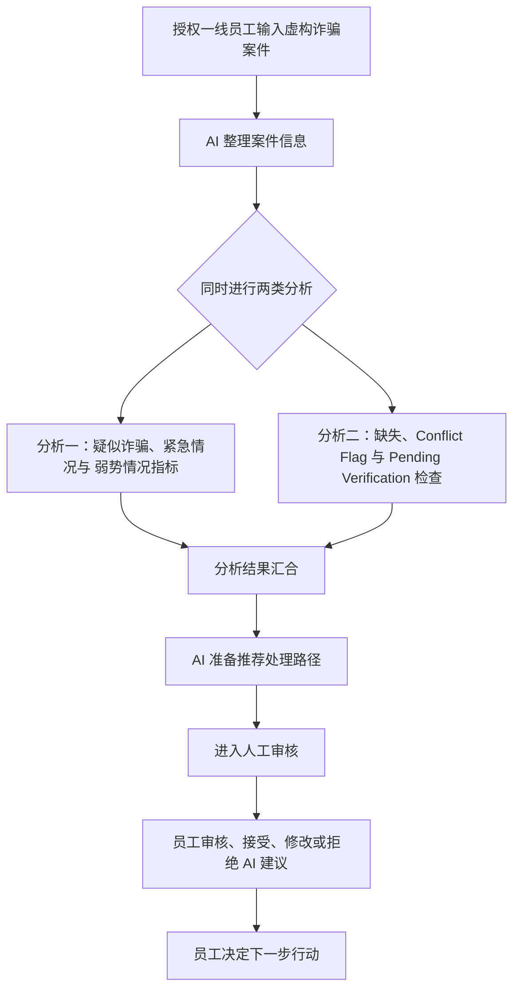

# ScamSafe Alliance AI 助手工作流程

**用于授权一线员工处理疑似诈骗案件的 AI 决策支持助手**

## 一、服务对象

本 AI 助手直接服务于 ScamSafe Alliance 成员机构中的授权一线员工。相关工作人员可以来自：

- 银行和支付服务商；
- 数字平台；
- 电信服务商；
- 身份恢复服务机构；
- 政府诈骗举报机构；
- 受害者援助组织；
- 社区支持机构；
- 所属机构指定的紧急人身安全联络人员。

本系统不是直接面向受到诈骗影响的个人的消费者聊天机器人。受到诈骗影响的人向联盟成员机构的一线员工报告情况，由一线员工将案件信息输入 AI 助手。AI 的输出供一线员工审核和使用，不直接提供给案件当事人。

## 二、服务场景

受到疑似诈骗影响的人联系 ScamSafe Alliance 的某个成员机构。一线员工接收对方提供的信息，并将案件情况输入 AI 助手。

案件信息可能完整、不完整、模糊、不确定、前后矛盾，或涉及可能需要立即处理和额外支持的情况。AI 助手不会因为资料不完整而直接拒绝案件，而是整理已经提供的信息，指出需要补充或核实的内容，并根据预先定义的 虚构规则 和 虚构指引 准备下一步处理建议。

当前原型只能使用 虚构案件信息。不得输入真实个人信息、敏感信息、机密信息或商业受限信息。

## 三、AI 与一线员工的职责划分

### 3.1 AI 助手的职责

AI 助手负责：

1. 整理一线员工输入的案件描述；
2. 将自然语言转换为清晰的结构化案件信息；
3. 根据 虚构规则 对案件是否呈现疑似诈骗特征进行辅助判断，并使用 suspected、reported、possible、unverified 等谨慎表达；
4. 根据 虚构规则 识别并标记可能的 弱势情况指标；
5. 找出缺失、矛盾、不确定或尚未核实的信息；
6. 根据 虚构规则 和 虚构指引 准备推荐处理路径；
7. 说明推荐的原因及其所依据的案件信息；
8. 将分析结果提交给一线员工进行人工审核。

AI 可以根据案件信息和预先定义的规则进行辅助判断，但不能把分析结果当作独立确认。AI 不进行医学、心理、法律或社会身份诊断，也不因没有发现 弱势情况指标 就证明当事人不存在任何困难或风险。

AI 不负责：

- 冻结交易；
- 修改账户；
- 直接联系其他机构；
- 自动提交案件；
- 自动转交案件；
- 自动采取影响案件当事人的最终行动；
- 代替授权一线员工承担责任。

### 3.2 一线员工的职责

一线员工负责：

1. 接收案件当事人提供的信息；
2. 将案件信息输入系统；
3. 查看 AI 对案件的整理和分析；
4. 检查 AI 是否正确理解案件；
5. 核实疑似诈骗判断、紧急情况和 弱势情况指标；
6. 核实缺失信息、Conflict Flag 和 Pending Verification；
7. 查看推荐处理路径及其理由；
8. 接受、修改或拒绝 AI 的建议；
9. 向案件当事人进行必要沟通；
10. 在自身权限和组织要求范围内决定并发起下一步行动；
11. 在需要时寻求主管、专家、紧急人身安全联络人员或其他授权人员的帮助。

核心原则是：AI 支持分析并准备建议；授权一线员工负责核实、沟通和采取行动。

## 四、整体工作流程

文字流程：授权一线员工输入虚构诈骗案件 → AI 整理案件信息 → 同时进行两类分析 → 分析结果汇合 → AI 准备推荐处理路径 → 进入人工审核 → 员工审核、接受、修改或拒绝 AI 建议 → 员工决定下一步行动。

疑似诈骗、紧急情况、弱势情况指标与信息质量检查属于并行分析，不规定严格先后顺序。最终输出应优先处理疑似诈骗、紧急情况和弱势情况。推荐处理路径之后必须进入人工审核，AI 建议不会直接变成最终行动。

## 五、每个流程步骤的说明

### 步骤 1：案件输入

授权一线员工将受到疑似诈骗影响的人提供的信息输入系统。输入可以是一段自然语言案件描述，也可以包含不完整、模糊或矛盾的信息。系统继续分析已经提供的内容，并指出需要补充或核实什么。

### 步骤 2：结构化案件信息

AI 将案件整理为以下四类信息。以下内容只说明每类信息的处理职责。

#### 1. 涉及的平台或机构

记录案件可能涉及的机构或平台，例如银行、支付服务商、数字平台、电信服务商、政府诈骗举报机构、身份恢复服务、受害者援助组织、社区支持机构或所属机构指定的紧急人身安全联络人员。如果目前无法判断，固定显示 “Unable to determine from the information provided.” 该信息只用于记录可能相关的机构或平台，不表示 AI 会自动联系或转交。

#### 2. 金额信息

记录案件中报告的金额。如果案件没有提供金额，固定显示 “Nothing reported.” 如果金额不清楚、缺失、不确定或存在多个互相矛盾的金额，应明确标记。金额信息不加入币种分析、付款方式、收款账户、交易渠道、银行账户号码或交易手续费，也不在本文件中设定任何金额阈值。

#### 3. 交易是否已经发生

记录交易状态时，`Transaction Status` 只使用规则中的固定英文标签：`CONFIRMED`、`DENIED` 或 `UNKNOWN`。如果相关信息尚未核实，另行使用 `Verification Status: Pending Verification` 表示待核实状态；`Pending Verification` 不属于交易状态。AI 只能根据案件描述和虚构规则进行辅助判断，不能把未经核实的内容当作确定事实。

#### 4. 案件概述

记录案件概述，包括事件经过、当事人报告的情况、可能涉及的诈骗方式、当前状态和需要进一步核实的内容。案件概述应使用“疑似”“据报告”“可能”和“尚未核实”等谨慎表达，不把 AI 的分析写成已经独立确认的诈骗事实。

### 步骤 3：疑似诈骗、紧急情况与 弱势情况指标 分析

此步骤用于帮助员工识别案件是否呈现疑似诈骗特征、是否可能需要立即人工处理，以及当事人是否可能需要额外沟通、理解或支持。

疑似诈骗判断依据案件描述和虚构规则，结果应说明判断依据和支持该判断的案件信息。对于弱势情况，AI 根据预先定义的规则检查可能的弱势情况指标：符合规则时进行标记；没有符合规则的指标时不标记。该结果仍需由一线员工审核，不构成医学、心理、法律或社会身份诊断。

该步骤输出疑似诈骗判断及其依据、紧急情况及 P1/P2/P3 等级、是否发现可能的弱势情况指标、发现了哪些指标、支持判断的案件信息，以及“需要人工审核”。紧急情况默认显示，不显示判断原因；只有发现弱势情况指标时才显示弱势情况指标，没有发现时不显示。

### 步骤 4：缺失、Conflict Flag 和 Pending Verification 检查

该步骤处理三类信息：

- **缺失信息**：显示缺少什么、为什么可能重要，以及员工可以进一步询问什么；
- **Conflict Flag**：标记矛盾涉及的主题、不同陈述和不一致原因；AI 不自行选择哪一项是真的；
- **Pending Verification**：标记尚未确认、表达模糊或只能暂时作为报告内容处理的信息，并说明员工可以进一步询问什么。

### 步骤 5：推荐处理路径

AI 根据结构化案件信息、疑似诈骗判断、紧急情况、弱势情况指标、缺失信息、Conflict Flag 和 Pending Verification，以及虚构规则和虚构指引，准备一条或多条推荐处理路径。

每条推荐大概包括：

- 推荐的下一步行动；
- 可能负责的机构、平台、行业或内部团队；
- 推荐原因；
- 支持建议的案件信息；
- 是否需要人工确认。

AI 只准备建议，不直接执行建议。如果案件信息不完整，AI 可以提供临时建议，同时指出需要员工补充的问题。不在本文件中规定真实银行、政府、电信公司或其他机构的正式程序。

### 步骤 6：人工审核

所有 AI 结果都必须进入人工审核。一线员工查看 AI 对案件的理解、疑似诈骗判断、紧急情况、弱势情况指标、信息质量问题和推荐处理路径，并可以接受、修改或拒绝 AI 建议，记录自己的审核意见。

AI 结果不能直接作为最终行动。

### 步骤 7：员工决定下一步行动

完成审核后，授权一线员工根据自身权限和组织要求决定真正采取什么行动。员工可以继续收集信息、向案件当事人提供适当说明或指导、请求主管或专家介入、联系所属机构指定的紧急人身安全联络人员、启动内部处理流程、准备案件记录或交接信息，或者暂时不采用某项 AI 建议。

最终责任仍属于授权一线员工，而不是 AI。

## 六、关键假设

1. 用户会诚实地、并在其所知范围内提供信息。
2. 风险分类以评估时可获得的信息和证据为基础。
3. 用户能够联系相关银行、平台、电信服务商或举报机构。
4. 员工角色和升级处理责任已经清楚定义。
5. 该框架用于初步风险分流，不用于作出法律或刑事认定。

## 七、关键局限性

1. ScamSafe Alliance 无法独立核实银行交易、账户访问记录或设备是否被入侵。
2. 不完整、模糊或前后矛盾的信息可能导致风险分类不准确。
3. 预先定义的规则不一定覆盖每一种新的或复杂的诈骗情形。
4. 推荐行动不能保证资金能够追回，也不能保证进一步伤害一定会被阻止。
5. 升级处理的效果取决于员工是否可用，以及外部机构的响应时间。

## 八、设计回应

为应对这些局限性，工作流程包括：

- 提出澄清问题；
- 对最高风险情况进行升级处理；
- 对不清楚或复杂的案件要求人工审核；
- 将需要独立核实的事项转介给相关外部机构；
- 要求员工在采取行动前检查 AI 的分析和建议。

这些设计回应不能消除系统的局限性，但可以减少因信息不足、规则覆盖有限或自动化判断过度而产生的风险。

## 九、已确认的规则对齐说明

1. **疑似诈骗判断**：AI 只根据案件发生的事情和虚构规则进行辅助分析，不把案件判定为已确认诈骗，也不独立判断诈骗已经发生。最终审核、决定和判断由授权一线员工完成。
2. **紧急程度**：内部保留 P1、P2、P3，用于表示根据不同情况判定出的优先级和严重程度。原型输出中显示相应等级；同时默认显示“紧急情况”，不显示判断原因。
3. **交易状态**：统一使用 `CONFIRMED`、`DENIED` 和 `UNKNOWN`。尚未核实的内容使用 `Pending Verification` 标记。
4. **四类重点信息**：涉及的平台或机构、金额信息、交易状态和案件概述，是分析结果中需要提取和展示的重点信息，不只是工作流程层级。
5. **信息质量标签**：尚未核实的信息统一使用 `Verification Status: Pending Verification`；矛盾信息统一使用 `Conflict Flag`。`Pending Verification` 不作为 `Transaction Status` 的额外类别。
6. **固定团队名称**：推荐路径和原型输出中纳入 Rules v4.1 定义的团队名称，包括 `Fraud / Scam Response`、`Card Fraud / Disputes`、`Payment Provider Fraud`、`Account Security`、`Trust & Safety`、`Platform Balance Support`、`Scam Messaging Reporting`、`Fraud & SIM Security`、`Identity Recovery Support`、`Scam Reporting & Case Coordination`、`Victim Support & Follow-up`、`Community Access & Practical Support` 和 `Designated Safety Contact`。具体团队根据案件涉及的机构和信息进行推荐，不表示 AI 会自动联系这些团队。
7. **弱势情况指标**：发现弱势情况指标时显示；没有发现时不显示。相关受害者援助、社区支持和指定紧急人身安全联络路径，只在案件信息和规则支持时纳入推荐。

## 十、系统边界

### AI 助手可以

- 整理案件信息；
- 根据 虚构规则 识别可能的问题和 indicators；
- 对疑似诈骗、紧急情况和 弱势情况指标 提供辅助判断；
- 准备推荐处理路径；
- 支持一致的案件审核。

### AI 助手不得

- 把分析结果当作独立确认的诈骗事实；
- 把弱势情况指标当作医学、心理、法律或社会身份诊断；
- 作出影响案件当事人的最终决定；
- 冻结交易；
- 修改账户；
- 直接联系其他机构；
- 自动提交或转交案件；
- 取代授权一线员工。

